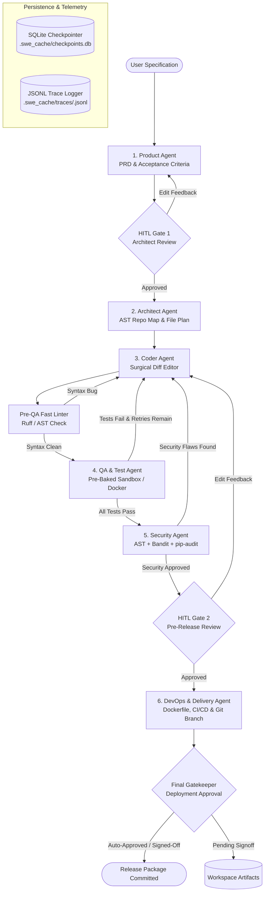

# 🚀 MAS-EDS: Multi-Agent Software Engineering & Continuous Delivery System

An autonomous, multi-agent software engineering swarm and continuous delivery system built with **Python**, **LangGraph**, **Docker**, and **Rich**.

MAS-EDS coordinates specialized AI agents across the complete software delivery lifecycle: from requirement specifications and modular architecture design, to sandboxed implementation, fast pre-QA linting, surgical diff editing, AST vulnerability scanning, automated testing, checkpoint persistence, and Git/CI/CD release delivery.

---

## 🏛️ System Architecture



---

## 🤖 The Swarm Personas

| Agent / Subsystem | Role | Responsibilities | Key Outputs |
| :--- | :--- | :--- | :--- |
| **Product Agent** | Product Architect | Deconstructs user prompts into structured PRDs with Given-When-Then criteria. | `PRDSpec`, `FeatureSpec` |
| **Architect Agent** | System Architect | Analyzes AST repo map, defines component boundaries, and plans dependencies. | `ArchitecturePlan` |
| **Coder Agent** | Senior SWE | Generates code or applies surgical diff search/replace with AST validation before disk writes. | `CodePatch`, `source_files` |
| **Pre-QA Fast Linter** | Linter Gate | Runs Ruff / AST syntax checks in milliseconds before triggering Docker/pytest. | `LinterResult` |
| **QA Agent** | Staff QA | Runs test suites in isolated sandboxes; compacts error tracebacks into state. | `TestExecutionResult` |
| **Security Agent** | AppSec Auditor | Multi-tier scanning: AST inspections, Bandit static analysis, and `pip-audit`. | `AuditReport`, `SecurityReview` |
| **DevOps Agent** | SRE / Delivery | Generates multi-stage Dockerfiles, GitHub Actions workflows, and Git branches. | `DeliveryArtifacts`, Git PR |
| **TUI Dashboard** | Telemetry / UX | Live split-pane terminal dashboard visualizing pipeline badges, diffs, and costs. | `LiveDashboard` |

---

## ⚙️ Quickstart Guide

### 1. Prerequisites
- Python 3.10+
- Git
- Docker (optional, for Dockerized sandbox mode)

### 2. Installation
```powershell
# Navigate to the project directory
cd C:\Users\lenovo\.gemini\antigravity\scratch\multi-agent-swe-delivery

# Create and activate virtual environment
python -m venv .venv
.\.venv\Scripts\Activate.ps1

# Install dependencies
pip install -r requirements.txt
```

### 3. Configure Environment
Copy `.env.example` to `.env` and configure your API keys:
```powershell
copy .env.example .env
```
Supported providers:
- `gemini`: Uses `GEMINI_API_KEY` (Gemini 1.5 Pro / Flash)
- `openai`: Uses `OPENAI_API_KEY` (GPT-4o)
- `mock` / `heuristic`: Built-in offline deterministic fallback for immediate dry-runs and automated testing without external API calls.

---

## 💻 CLI Usage (`swe` & `mas`)

The CLI is available as `swe` or `mas` (or run via `python -m src.cli`):

### 1. Run an Autonomous SWE Lifecycle
```powershell
# Interactive run with Live Split-Pane TUI and HITL gates (default when TTY is attached)
python -m src.cli run "Build an in-memory token bucket rate limiter service"

# Automated run bypassing HITL prompts (ideal for CI / unattended runs)
python -m src.cli run "Build an in-memory token bucket rate limiter service" --yes

# Resume a previous paused or interrupted run by thread ID
python -m src.cli run --resume task_94ff7537
```

#### CLI Flags & Options:
- `--interactive` / `-i`: Enable interactive Human-in-the-Loop gates (defaults to `True` on TTY).
- `--no-interactive`: Disable interactive prompts and run non-interactively.
- `--auto-approve` / `-y` / `--yes`: Auto-approve all deployment gates and bypass HITL prompts.
- `--resume <thread_id>`: Resume an interrupted or checkpointed run using its thread ID.
- `--sandbox local` (default) or `--sandbox docker`: Choose local process or Docker sandbox execution.
- `--max-retries <int>`: Maximum automated repair iterations (default: `3`).
- `--session-id <id>`: Custom session identifier for the workspace directory.

### 2. View Saved Checkpoints & Runs (`swe runs`)
Inspect all previous executions, prompts, statuses, costs, and durations:
```powershell
python -m src.cli runs
```
In an interactive terminal, you can select any run by number to immediately `--resume` or `--replay` it.

### 3. Interactive Trace Replayer (`swe replay <run_id>`)
Step through recorded `.jsonl` trace events step-by-step with exact agent thoughts, syntax-highlighted code diffs, latency, and token costs:
```powershell
python -m src.cli replay task_94ff7537
```

---

## 🐳 Pre-Baked Docker Sandbox (`docker/sandbox.Dockerfile`)

For containerized test execution, build the pre-baked sandbox image:
```powershell
docker build -f docker/sandbox.Dockerfile -t swe-sandbox:latest .
```

The sandbox image provides:
- Lightweight `python:3.11-slim` runtime.
- Pre-installed `git`, `pytest`, `pytest-asyncio`, `pytest-cov`, `ruff`, `bandit`, and `pip-audit`.
- Hardened unprivileged `sandbox` non-root user (`uid 1000`).
- Isolated `/workspace` bind mount.

Run MAS-EDS with Docker sandbox mode:
```powershell
python -m src.cli run "Build microservice" --sandbox docker
```

---

## 🌐 Web Console & API Server

MAS-EDS includes a full-stack Web Console connecting frontend and backend APIs:
```powershell
python -m src.cli serve --port 8080
```
Open **`http://localhost:8080`** to monitor agent swarms, inspect source files, view unified diffs, request revisions, and download delivery packages.

---

## ☁️ Deploying Backend to Render

MAS-EDS is fully configured for deployment on [Render](https://render.com) using either **Render Blueprints (Infrastructure-as-Code)** or a **Standard Web Service / Docker Service**.

### Option A: Render Blueprint (Recommended)
1. Push your repository to GitHub.
2. In the [Render Dashboard](https://dashboard.render.com), click **New +** > **Blueprint**.
3. Select your repository. Render automatically reads [`render.yaml`](file:///C:/Users/lenovo/.gemini/antigravity/scratch/multi-agent-swe-delivery/render.yaml).
4. Configure your secret environment variables:
   - `GEMINI_API_KEY` or `OPENAI_API_KEY`
5. Click **Apply**. Render will deploy the `mas-eds-backend` service.

### Option B: Manual Web Service / Docker Deployment
1. Click **New +** > **Web Service**.
2. Select your repository.
3. Configure the service:
   - **Environment**: `Docker` (or `Python 3`)
   - **Build Command** (Python): `pip install -r requirements.txt`
   - **Start Command** (Python): `python -m src.server`
   - **Health Check Path**: `/health`
4. Add the required Environment Variables:
   - `HOST`: `0.0.0.0`
   - `PORT`: `8080` (or leave default, Render sets `$PORT` dynamically)
   - `SANDBOX_MODE`: `local`
   - `LLM_PROVIDER`: `gemini` (or `openai` / `heuristic`)
   - `GEMINI_API_KEY`: `<your_gemini_api_key>`
5. Deploy service. Render will monitor the `/health` endpoint and route traffic automatically.

---

## ⚡ Connecting Vercel Frontend to Render Backend

You can host the UI on [Vercel](https://vercel.com) and the Python execution engine on Render:

1. **Deploy Frontend on Vercel**:
   Deploy the repository with `vercel` or via Git integration using [`vercel.json`](file:///C:/Users/lenovo/.gemini/antigravity/scratch/multi-agent-swe-delivery/vercel.json).
2. **Connect to Render**:
   - Open your deployed Vercel frontend in your browser.
   - Click the **Backend Connection Badge** in the top navigation bar (`Backend: Localhost (Click to Change)`).
   - Enter your Render backend URL (e.g. `https://mas-eds-backend.onrender.com`).
   - The frontend will persist this configuration in `localStorage` and route all API calls (`/api/run`, `/api/sessions`, `/api/diff`, etc.) to your Render backend with full CORS support.

---

## 🧪 Testing Suite & CI

Run the complete test suite (unit tests, tools, security audits, TUI, and E2E self-healing pipeline):
```powershell
python -m pytest -v tests
```

### GitHub Actions CI
The repository includes automated CI at `.github/workflows/ci.yml` verifying `ruff check src tests` and `pytest -v` across Python 3.11 and 3.12 on every push and pull request.

---

## 📦 Output Artifacts

Each run generates an isolated workspace at `./workspaces/<session-id>/` containing:
- 🐍 **Application Code**: Modular source code with surgical syntax validation.
- 🧪 **Test Suite**: Automated `pytest` unit test suites.
- 🐳 **Containerization**: Hardened multi-stage `Dockerfile` and `docker-compose.yml`.
- ⚙️ **CI/CD Pipeline**: `.github/workflows/ci-cd.yml` with linting, security scans, and container delivery.
- 🌿 **Git Feature Branch**: Clean Git branch (`feature/<app>-automated-delivery`) with committed changes.
